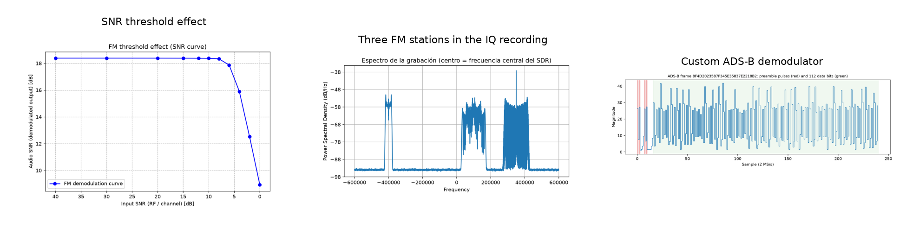
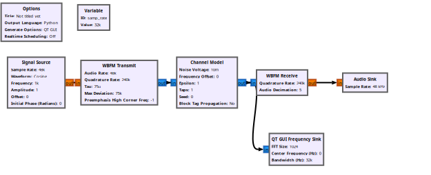
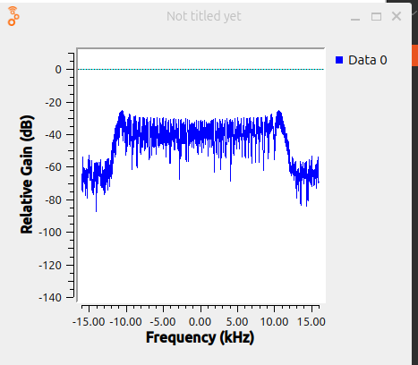
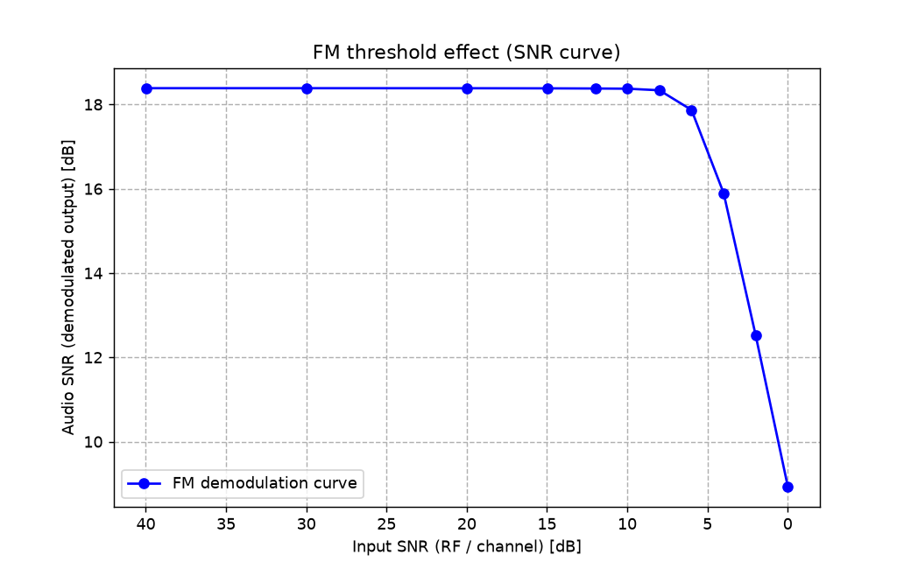
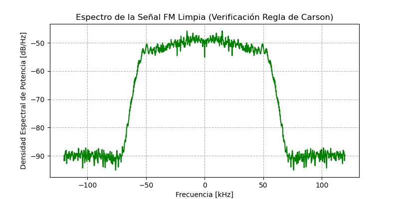
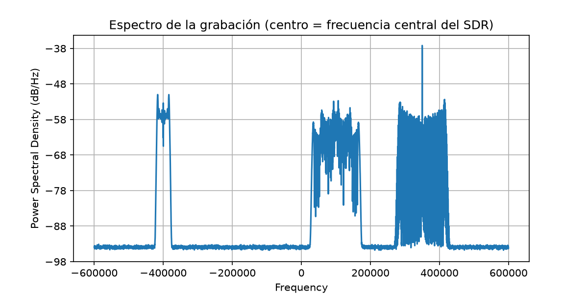
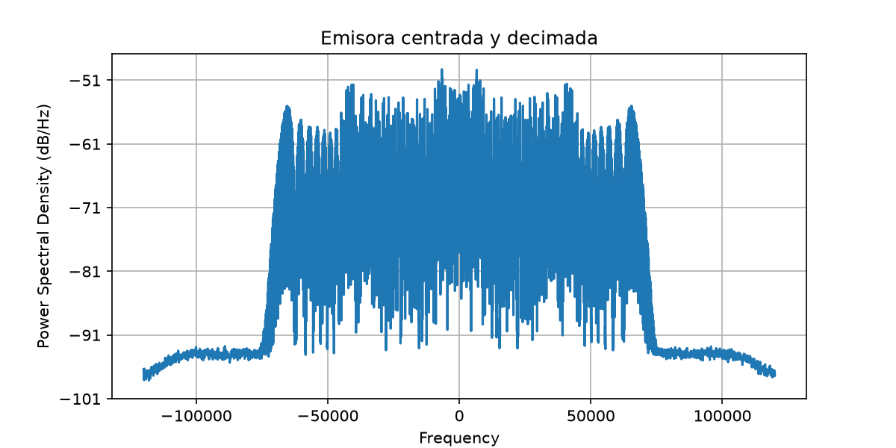
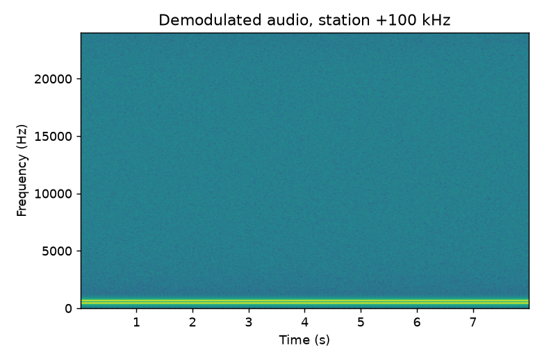
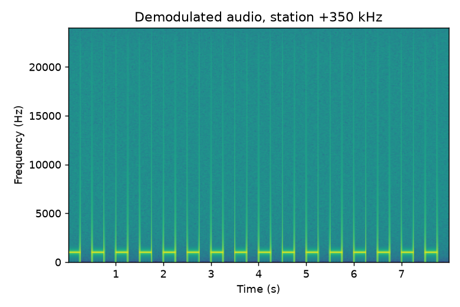
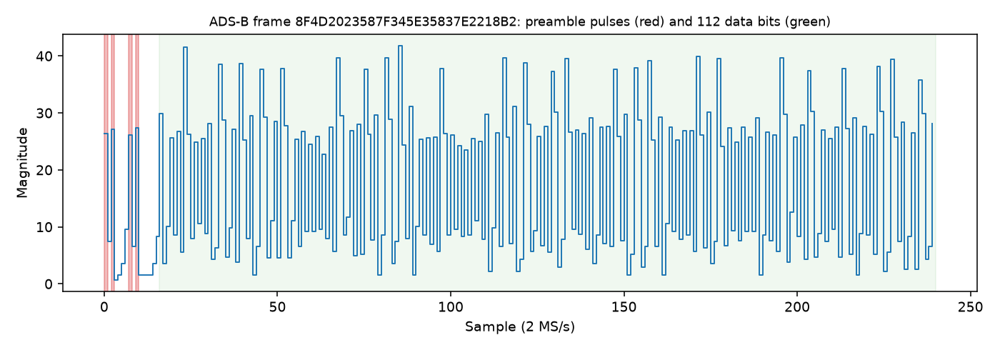

# 📡 Software-Defined Radio: Signal Reception and Analysis

Simulation and analysis of radio signals with **GNU Radio** and **Python**, entirely in software and without hardware: a wideband FM chain with an SNR sweep, demodulation of a multi-station IQ recording, and ADS-B aircraft decoding with a custom demodulator written from scratch.


<p align="center"></p>

---

## Table of contents

1. [Overview](#overview)
2. [Background](#background)
3. [Repository contents](#repository-contents)
4. [Installation](#installation)
5. [Part 1: Simulated FM chain and SNR sweep](#part-1-simulated-fm-chain-and-snr-sweep)
6. [Part 2: FM demodulation of an IQ recording](#part-2-fm-demodulation-of-an-iq-recording)
7. [Part 3: ADS-B decoding with dump1090 and pyModeS](#part-3-ads-b-decoding-with-dump1090-and-pymodes)
8. [Part 4: Custom ADS-B demodulator](#part-4-custom-ads-b-demodulator)
9. [Limitations](#limitations)
10. [References](#references)

---

## Overview

| Part | Goal | Main tools |
|---|---|---|
| 1 | Simulate a WBFM transmit/receive chain and measure how audio quality drops as the input SNR falls | GNU Radio, NumPy, SciPy |
| 2 | Locate, shift, filter and demodulate FM stations inside a wideband IQ recording | SciPy, own FM discriminator |
| 3 | Decode ADS-B (Mode S, DF17) messages from an IQ file and build a per-aircraft table | dump1090, pyModeS |
| 4 | Write an ADS-B demodulator from scratch (PPM + CRC-24) and compare it with dump1090 | NumPy |

## Background

- **IQ samples**: complex samples (I + jQ) describing the spectrum around a centre frequency.
- **Broadcast FM**: the information is carried in the instantaneous frequency. Europe uses a maximum deviation of 75 kHz and 50 µs pre-emphasis. Carson's rule gives a bandwidth of about 2·(75 + 15) = **180 kHz**.
- **ADS-B**: pulse-position modulation at 1 Mbit/s on 1090 MHz, with 112-bit frames protected by a 24-bit CRC.

---

## Repository contents

| File | Description |
|---|---|
| `fm_sim.py` | Simulated WBFM chain (GNU Radio), SNR sweep, CSV, threshold plot and PSD (Carson's rule check) |
| `gen_fm_iq.py` | Generates a synthetic 1.2 MS/s IQ recording with three FM stations plus noise |
| `fm_real.py` | Custom FM demodulator for an IQ recording: spectrum, audio, spectrogram and optional GNU Radio comparison |
| `fm_stations.py` | Demodulates the three stations, saves their spectrograms and measures audio SNR against the original |
| `adsb_decode.py` | Decodes DF17 frames with pyModeS and builds a per-aircraft table |
| `adsb_demod.py` | Custom ADS-B demodulator (PPM at 2 MS/s, CRC-24) and comparison with dump1090 |
| `make_figures.py` | Builds the ADS-B frame plot, the threshold plot and the banner |
| `flowgraphs/fm_chain.grc` | GNU Radio Companion flowgraph of the FM chain |
| `data/` | CSVs and results (large and third-party files are not included) |
| `figures/` | Plots used in this README and the report |
| `report.pdf` | Technical report |

---

## Installation

Tested on Ubuntu (virtual machine).

```bash
sudo apt install -y gnuradio python3-numpy python3-scipy python3-matplotlib python3-pandas \
  build-essential git librtlsdr-dev libusb-1.0-0-dev pkg-config
python3 -m venv --system-site-packages venv && source venv/bin/activate
pip install pyModeS
python3 -c "from gnuradio import analog; print('ok')"
```

`--system-site-packages` lets the virtual environment see the GNU Radio installed through `apt`.

---

## Part 1: Simulated FM chain and SNR sweep

### Flowgraph

The chain was first built in GNU Radio Companion:
**Signal Source → WBFM Transmit → Channel Model → WBFM Receive → Audio Sink**, with a **QT GUI Frequency Sink** after the receiver to watch the spectrum.

<p align="center"></p>

<p align="center"></p>

### SNR sweep (`fm_sim.py`)

For the sweep, the same chain is rebuilt in Python with a custom noise source so the input SNR is controlled exactly. A 3-tone test signal (440 Hz, 1 kHz, 3 kHz) is frequency-modulated (75 kHz deviation, 50 µs pre-emphasis, 240 kS/s), complex Gaussian noise is added, and the result is demodulated with `wfm_rcv`. The audio SNR is measured against the original signal after aligning delay and gain by cross-correlation.

```bash
python fm_sim.py   # -> data/fm_snr_sweep.csv, figures/fm_threshold.png, figures/fm_carson_psd.png
```

| Input SNR (dB) | Audio SNR (dB) |
|---:|---:|
| 40.0 | 18.4 |
| 30.0 | 18.4 |
| 20.0 | 18.4 |
| 15.0 | 18.4 |
| 12.0 | 18.4 |
| 10.0 | 18.4 |
| 8.0 | 18.3 |
| 6.0 | 17.9 |
| 4.0 | 15.9 |
| 2.0 | 12.5 |
| 0.0 | 8.9 |

<p align="center"></p>

**The FM threshold effect.** Down to about 8 dB of input SNR the audio SNR stays flat at ~18.4 dB. That plateau is the ceiling of the simulated chain itself (not channel noise), so extra input SNR no longer helps. Below roughly 6–8 dB the curve bends sharply: the noise starts causing phase "clicks" in the discriminator, and the audio SNR falls much faster than the input SNR. That knee is the characteristic FM threshold effect.

### Spectrum and Carson's rule

The Welch PSD of the clean FM signal shows a bandwidth of roughly ±65 kHz (~130 kHz). This is below the 180 kHz of the textbook case because the test tones do not drive the modulator to the full 75 kHz deviation or to 15 kHz audio bandwidth; applying Carson's rule with the actual peak deviation and highest audio frequency (3 kHz) gives a consistent estimate.

<p align="center"></p>

---

## Part 2: FM demodulation of an IQ recording

Since no suitable real recording was available, `gen_fm_iq.py` creates a **synthetic** wideband IQ file (1.2 MS/s, 8 s) containing three FM stations plus noise. Because the original audio of each station is known, the quality of the demodulator can be measured, which is not possible with an unknown real recording.


| Station offset | Content |
|---:|---|
| −400 kHz | Audio sweep, 300 Hz → 3 kHz |
| +100 kHz | Two tones, 440 Hz and 660 Hz |
| +350 kHz | 1 kHz beeps, on/off twice per second |

### Demodulation pipeline (`fm_real.py`)

1. Load the IQ file and normalise it.
2. Multiply by `e^(−j2π·f0·n/fs)` to shift the chosen station to 0 Hz.
3. Low-pass and decimate to 240 kS/s (this also removes the other stations).
4. FM discriminator: `angle(x[n] · conj(x[n−1]))`.
5. 50 µs de-emphasis, then resample to 48 kHz audio.
6. Optionally compare with GNU Radio's `wfm_rcv` (`--gr`).

```bash
python gen_fm_iq.py
python fm_real.py data/fm_sintetico.cf32 --fs 1200000 --f0 0        # 1st pass: inspect the spectrum
python fm_real.py data/fm_sintetico.cf32 --fs 1200000 --f0 100000   # demodulate the +100 kHz station
python fm_stations.py                                               # all three stations + SNR table
```

### Results

**Wideband spectrum.** The three stations are clearly separated at −400 kHz, +100 kHz and +350 kHz (the narrow spike near +350 kHz is the 1 kHz beep tone).

<p align="center"></p>

**Centred station.** After shifting and decimating, only the selected station remains.

<p align="center"></p>

**Demodulated audio spectrograms.** One per station, confirming each station's expected content.

<p align="center">
  
  
  
</p>

**Audio quality per station** (`python fm_stations.py`), measured against the known original audio after aligning delay and gain:

| Station | Audio SNR (dB) |
|---:|---:|
| −400 kHz | 31.7 |
| +100 kHz | 41.1 |
| +350 kHz | 36.3 |

These values are a lower bound: the generator's pre-emphasis is only approximate and does not exactly match the 50 µs de-emphasis used when demodulating. The sweep is the hardest case for the discriminator (the rising tone reaches the highest audio frequencies), which is consistent with it scoring lowest.

---

## Part 3: ADS-B decoding with dump1090 and pyModeS

dump1090 decodes the test file `testfiles/modes1.bin` (8-bit unsigned IQ at 2 MS/s). Its raw output is then parsed with pyModeS (2.x API), keeping only valid DF17 frames (CRC = 0) and grouping them by aircraft.

```bash
git clone https://github.com/antirez/dump1090.git && (cd dump1090 && make)
./dump1090/dump1090 --ifile dump1090/testfiles/modes1.bin --raw > data/frames.txt
python adsb_decode.py data/frames.txt
```

### Result

| ICAO | Callsign | Altitude (ft) | Speed (kt) |
|---|---|---:|---:|
| 4D2023 | AMC421 | 20025 | N/A |

The test file is short, so only one aircraft yields a complete identification and altitude message; no velocity message (type code 19) was present, hence `N/A`.


---

## Part 4: Custom ADS-B demodulator

`adsb_demod.py` reimplements the demodulation chain on the raw IQ file:

1. Convert unsigned 8-bit samples to complex IQ and take the magnitude.
2. Detect the 16-sample preamble (pulses at samples 0, 2, 7 and 9, with low samples in between).
3. At 2 MS/s each bit is two samples: bit = 1 if the first sample is larger than the second, else 0. Decode 112 bits.
4. Validate with the 24-bit CRC (polynomial `0x1FFF409`); keep only frames with remainder 0.
5. Compare against dump1090's DF17/18 frames.

```bash
python adsb_demod.py data/modes1.bin data/frames.txt
```

### Comparison with dump1090

On `modes1.bin`, both decoders were run and their DF17/18 frames compared (`python adsb_demod.py data/modes1.bin data/frames.txt`):

| Metric | Count |
|---|---:|
| Frames found by dump1090 (DF17/18) | 159 (111 unique, out of 178 total frames of any type) |
| Frames found by the custom demodulator | 141 (101 unique) |
| Identical frames in both (unique) | 101 |
| Only in the custom demodulator | 0 |
| Only in dump1090 | 10 |

Every frame found by the custom demodulator is also in dump1090's output (no false positives, thanks to the CRC check), but it misses 10 of dump1090's 111 unique frames (~9 %). Decoding the frames with `adsb_decode.py` gives the same single aircraft: `4D2023`, callsign `AMC421`.

<p align="center"></p>
Differences are expected: dump1090 uses more tolerant preamble detection and can repair some frames, whereas this demodulator applies a strict preamble check and a plain 2-sample bit decision with no error correction.

---

## Limitations

- Simulation and third-party recordings: there is no capture of our own with hardware.
- The FM recording of Part 2 is synthetic, not a real over-the-air capture.
- Ideal AWGN noise; no fading or multipath in the sweep.
- Third-party files (dump1090's `modes1.bin`) have their own licences: they are not included in the repository, only linked.

## References

- GNU Radio: https://www.gnuradio.org
- dump1090 (antirez): https://github.com/antirez/dump1090
- pyModeS: https://mode-s.org
- SDRplay sample IQ recordings: https://www.sdrplay.com
- SigMF (IQ metadata format): https://sigmf.org


